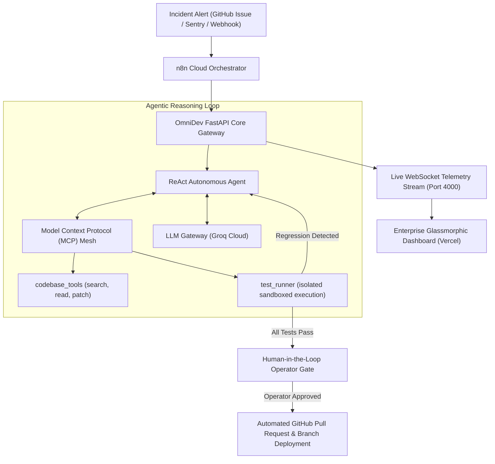

# OmniDev — Autonomous Agentic Software Engineering & Self-Healing Pipeline

[](#)
[](#)
[](#)
[](#)

> **OmniDev** is an enterprise-grade autonomous software engineering platform. It listens for incident alerts, explores the codebase using the **Model Context Protocol (MCP)**, reproduces bugs in isolated test sandboxes, computes minimal surgical diffs, and opens verified Pull Requests on GitHub with Human-in-the-Loop approval.

---

## Architecture Overview



---

## Repository Structure

```text
├── src/
│   ├── agent/                 # ReAct reasoning loop, LLM provider, prompt orchestration
│   ├── mcp/                   # Model Context Protocol tools (search, read, patch, test)
│   ├── sample_app/            # Target codebase under test (calculator, business logic)
│   ├── server/                # FastAPI application, database stores, WebSocket & REST routes
│   └── github_client.py       # Asynchronous GitHub REST client (branches, commits, PRs)
├── static/                    # Dark glassmorphic frontend UI (Linear / Raycast design)
│   ├── index.html             # High-impact platform landing page & live telemetry
│   ├── console.html           # Nerve Center: incident orchestration & approval dock
│   ├── workspace.html         # Git-tracked Codebase Explorer & Monaco-style viewer
│   ├── analytics.html         # Real-time incident analytics & resolution rate meters
│   ├── integrations.html      # DevOps service health & ingress endpoints
│   ├── settings.html          # Operator profile, Git credentials & LLM controls
│   ├── rules.html             # Agent governance playbook & safety policies
│   ├── docs.html              # Architecture specifications & REST API reference
│   ├── aurora.css             # Glassmorphic design system styles
│   ├── aurora-canvas.js       # Interactive particles & dynamic DOM interactions
│   └── api-config.js          # Cloud gateway resolver for Vercel/Render deployments
├── tests/
│   └── test_all.py            # Comprehensive 17-point test suite (100% pass rate)
├── .env.example               # Template environment configuration (no secrets)
├── .gitignore                 # Exclusion rules for secrets, DBs, and virtualenvs
├── n8n_workflow.json          # Sanitized workflow template for n8n Cloud
├── vercel.json                # Vercel static clean URLs & routing configuration
├── render.yaml                # Render Blueprint infrastructure-as-code configuration
├── Procfile                   # Process file for Render web deployment
└── requirements.txt           # Python dependencies
```

---

## Local Development Quickstart

### 1. Prerequisites
- Python 3.12+
- Git

### 2. Environment Setup
```bash
# Clone repository
git clone https://github.com/ruthwikreddy07/wpmmain.git
cd wpmmain

# Create virtual environment
python -m venv .venv
source .venv/bin/activate  # On Windows: .\.venv\Scripts\activate

# Install dependencies
pip install -r requirements.txt

# Configure environment variables
cp .env.example .env
# Fill in GITHUB_REPO, GITHUB_TOKEN, and GROQ_API_KEY in .env
```

### 3. Run Unit Tests
```bash
python -m unittest tests/test_all.py
```

### 4. Start Local Server
```bash
uvicorn src.server.app:app --host 0.0.0.0 --port 4000 --reload
```
Open **http://localhost:4000** in your browser.

---

## Cloud Deployment

### 1. Backend &rarr; Render
1. Create a new **Web Service** on [Render](https://dashboard.render.com/) pointing to your repository.
2. Settings:
   - **Runtime:** `Python 3`
   - **Build Command:** `pip install -r requirements.txt`
   - **Start Command:** `uvicorn src.server.app:app --host 0.0.0.0 --port $PORT`
3. Environment Variables:
   - `PYTHON_VERSION`: `3.12.0`
   - `GITHUB_REPO`: `your-username/your-repo`
   - `GITHUB_TOKEN`: Your GitHub Personal Access Token
   - `GROQ_API_KEY`: Your Groq Cloud API Key

### 2. Frontend &rarr; Vercel
1. Import the repository into [Vercel](https://vercel.com/).
2. Select **Framework Preset:** `Other` (Vercel automatically detects `vercel.json`).
3. Deploy!
4. On your Vercel deployment, navigate to **Settings** &rarr; **Ingress & Webhooks** and paste your Render URL in **Cloud Backend Target**.

---

## Security & Privacy Guarantee

- **Zero Credential Leaks:** Secrets are strictly loaded via environment variables (`.env`).
- **Sanitized Workflows:** `n8n_workflow.json` uses environment variables and contains zero hardcoded tokens.
- **Subprocess Sandboxing:** Code modification and test execution are constrained to the project directory boundary.

---

## Author & Maintainer
- **Lead Architect:** D. Ruthwik Reddy ([ruthwikreddy07](https://github.com/ruthwikreddy07))
- **Role:** Principal SRE & AI Systems Lead
