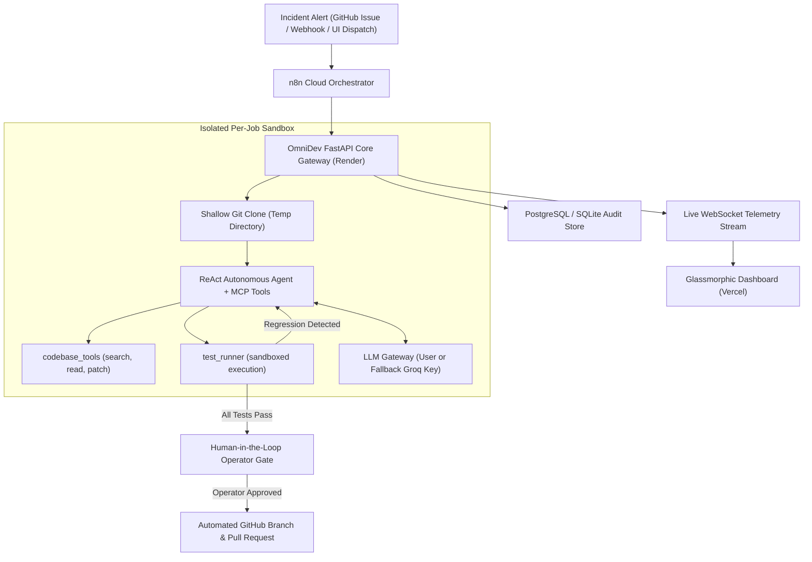

# OmniDev — Autonomous Agentic Software Engineering & Self-Healing Pipeline

[](#)
[](#)
[](#)
[](#)

> **OmniDev** is a multi-tenant autonomous software engineering platform. Each operator connects their own GitHub repository, optional GitHub PAT, and Groq API key in their browser session—allowing OmniDev to shallow-clone the target repo into an isolated sandbox, reproduce bugs, compute minimal surgical diffs, and open verified Pull Requests on GitHub with Human-in-the-Loop approval.

---

## Architecture Overview



---

## Repository Structure

```text
├── src/
│   ├── agent/                 # ReAct reasoning loop, LLM provider, prompt orchestration
│   ├── mcp/                   # Model Context Protocol tools (search, read, patch, test)
│   ├── sample_app/            # Sample target app for local sandbox testing
│   ├── server/                # FastAPI app, PostgreSQL/SQLite store, WebSocket & REST routes
│   └── github_client.py       # Asynchronous GitHub REST client (branches, commits, PRs)
├── static/                    # Dark glassmorphic frontend UI
│   ├── index.html             # Platform landing page & live terminal preview
│   ├── auth.html              # Operator sign-in / onboarding redirect
│   ├── console.html           # Nerve Center: incident orchestration & approval dock
│   ├── workspace.html         # Live GitHub Codebase Explorer & file viewer
│   ├── analytics.html         # Repo-scoped incident telemetry & resolution metrics
│   ├── integrations.html      # DevOps service health, WebSocket & webhook endpoints
│   ├── settings.html          # Operator profile, Git credentials, Groq key & backend URL
│   ├── rules.html             # Agent governance playbook & safety policies
│   ├── docs.html              # Architecture specifications & REST API reference
│   ├── logo.svg               # Custom OmniDev cyber-neural SVG emblem & favicon
│   ├── aurora.css             # Glassmorphic design system styles
│   ├── aurora-canvas.js       # Interactive background particles
│   └── api-config.js          # Multi-tenant session controller & Vercel/Render API resolver
├── .env.example               # Template environment configuration (no secrets)
├── .gitignore                 # Excludes .env, *.db, tests/, virtualenvs, and internal docs
├── n8n_workflow.json          # Sanitized workflow template for n8n Cloud
├── vercel.json                # Vercel static clean URLs & security headers
├── render.yaml                # Render Blueprint infrastructure-as-code configuration
├── Procfile                   # Process file for Render web deployment
└── requirements.txt           # Python dependencies (including psycopg[binary])
```

---

## Local Development Quickstart

### 1. Prerequisites
- Python 3.12+
- Git

### 2. Environment Setup
```bash
# Clone repository
git clone https://github.com/ruthwikreddy07/OmniDev.git
cd OmniDev

# Create virtual environment
python -m venv .venv
source .venv/bin/activate  # On Windows: .\.venv\Scripts\activate

# Install dependencies
pip install -r requirements.txt

# Optional: copy .env.example to .env for local defaults (uses SQLite automatically if DATABASE_URL is blank)
cp .env.example .env
```

### 3. Start Local Server
```bash
uvicorn src.server.app:app --host 0.0.0.0 --port 4000 --reload
```
Open **http://localhost:4000** in your browser, click **`+ Connect Repo`**, and enter any GitHub `owner/repo` (plus optional GitHub PAT & Groq API key).

---

## Cloud Deployment (Render + Vercel + PostgreSQL)

### 1. Database &rarr; PostgreSQL (Neon / Supabase / Render Postgres)
Because Render's free web service disk is ephemeral, connect an external **PostgreSQL** database so jobs and audit logs persist across restarts:
1. Create a free PostgreSQL database on [Neon](https://neon.tech/), [Supabase](https://supabase.com/), or Render PostgreSQL.
2. Copy the connection string (`postgresql://...`).

### 2. Backend &rarr; Render
1. Create a new **Web Service** on [Render](https://dashboard.render.com/) connected to `ruthwikreddy07/OmniDev` (`main` branch).
2. Settings (auto-detected from [render.yaml](render.yaml)):
   - **Runtime:** `Python 3`
   - **Build Command:** `pip install -r requirements.txt`
   - **Start Command:** `uvicorn src.server.app:app --host 0.0.0.0 --port $PORT`
3. Environment Variables on Render:
   - `PYTHON_VERSION`: `3.12.0`
   - `DATABASE_URL`: Your PostgreSQL connection string *(SSL is handled automatically)*
   - `N8N_WEBHOOK_URL`: `https://n8n-mr7m.onrender.com/webhook/omnidev-github-incident` *(optional)*
   - `GROQ_API_KEY`: *(Optional fallback—leave blank if you want every user to supply their own Groq key in the UI)*
   - **Do NOT set `GITHUB_REPO` or `GITHUB_TOKEN` on Render**—each visitor connects their own repository in their browser session.

### 3. Frontend &rarr; Vercel
1. Import `ruthwikreddy07/OmniDev` into [Vercel](https://vercel.com/).
2. Select **Framework Preset:** `Other` (uses [vercel.json](vercel.json) clean URLs).
3. Click **Deploy**.
4. Open your Vercel site &rarr; **Settings** (`/settings`) &rarr; **Cloud Backend Target**, paste your Render URL (e.g., `https://omnidev-backend.onrender.com`), and save.

---

## Security, Multi-Tenant Isolation & User Privacy

- **Zero Server-Side Secret Storage (Client-Side Custody):** Users' **GitHub Personal Access Tokens** and **Groq API Keys** are stored **exclusively in their own browser's `localStorage`** and transmitted over HTTPS (`X-GitHub-Token`, `X-Groq-Api-Key`) only for the active request. They are **never** written to PostgreSQL, `.env`, or server logs—even the platform administrator cannot view or extract user tokens from the database.
- **Ephemeral Isolated Workspaces:** Each agent job shallow-clones the user's target repository into a unique temporary directory, redacts tokens from any error output, and deletes the workspace immediately after generating diffs.
- **Strict Tenant Isolation:** `GET /api/jobs`, `GET /api/telemetry`, and single-job endpoints enforce `X-Target-Repo` scoping (`HTTP 403` on cross-repo access), and `AgentExecutor` enforces strict workspace path-containment guards.
- **Zero-Leakage Defaults:** Unauthenticated requests never receive server `.env` values, masked tokens, or host filesystem internals.

---

## Author & Maintainer
- **Lead Architect:** D. Ruthwik Reddy ([ruthwikreddy07](https://github.com/ruthwikreddy07))
- **Role:** Principal SRE & AI Systems Lead
